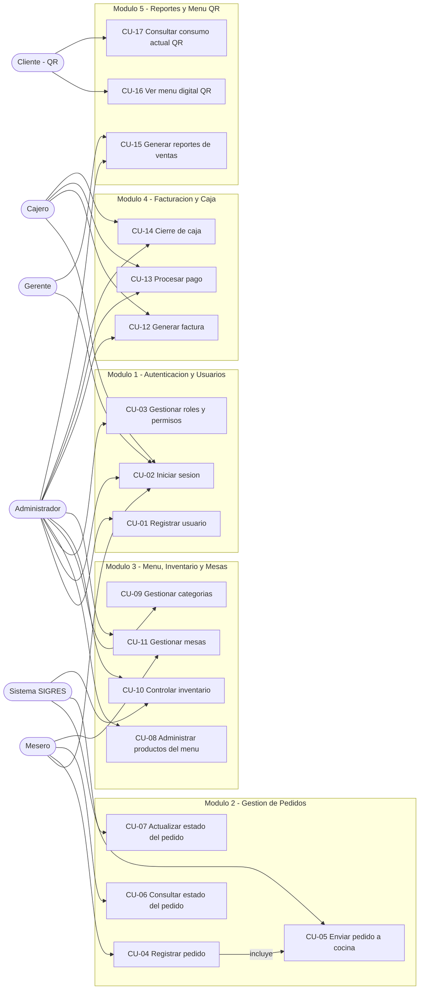

# Diagrama de Casos de Uso — SIGRES

**Proyecto:** Sistema Integral de Gestion para Restaurantes
**Version:** 1.0 | **Fecha:** Noviembre 2026
**Basado en:** SRS-SIGRES v1.0

---

## Actores del sistema

| Actor | Tipo | Plataforma | Descripcion |
|---|---|---|---|
| Administrador | Principal | Web | Gestion total del sistema |
| Mesero | Principal | App movil | Registro de pedidos y mesas |
| Cajero | Principal | Web | Facturacion y pagos |
| Gerente | Principal | Web | Consulta de reportes e indicadores |
| Cliente | Principal | Movil via QR | Consulta del menu y consumo sin autenticacion |
| Sistema SIGRES | Secundario | Interno | Ejecucion de logica automatizada |

---

## Diagrama UML de Casos de Uso

---

## Relaciones entre casos de uso

| Relacion | Tipo | Descripcion |
|---|---|---|
| CU-04 a CU-05 | include | Registrar pedido siempre incluye enviarlo a cocina |
| CU-04 a CU-06 | extend | El mesero puede consultar el estado tras registrar el pedido |
| CU-12 a CU-13 | extend | Generar factura puede extenderse al procesamiento del pago |
| CU-16 a CU-17 | extend | Ver menu puede extenderse a consultar consumo si hay pedido activo |
| CU-02 a CU-03 | extend | El inicio de sesion extiende la gestion de roles para el administrador |

---

## Caracterizacion de Casos de Uso

### CU-01: Registrar Usuario

| Campo | Detalle |
|---|---|
| Actor principal | Administrador |
| RF asociado | RF01 |
| Prioridad | Alta — Critico |
| Precondicion | El administrador esta autenticado en el sistema |
| Postcondicion | El usuario queda registrado con el rol asignado y puede iniciar sesion |
| Flujo principal | 1. El administrador accede al modulo de gestion de usuarios. 2. Selecciona la opcion de nuevo usuario. 3. Ingresa nombre, correo, contrasena y rol. 4. El sistema valida que el correo no este registrado. 5. Se crea el usuario y se muestra confirmacion. |
| Error principal | Correo duplicado: "El correo ya se encuentra registrado en el sistema." |

### CU-02: Iniciar Sesion

| Campo | Detalle |
|---|---|
| Actor principal | Administrador / Mesero / Cajero / Gerente |
| RF asociado | RF02 |
| Prioridad | Alta — Critico |
| Precondicion | El usuario esta registrado con credenciales activas |
| Postcondicion | El usuario accede al panel correspondiente a su rol. Se genera un token JWT de sesion. |
| Flujo principal | 1. El usuario ingresa correo y contrasena. 2. El sistema valida las credenciales. 3. Se genera el token de sesion. 4. El sistema redirige al panel del rol correspondiente. |
| Error principal | "Correo o contrasena invalidos." / "La cuenta se encuentra desactivada." |

### CU-04: Registrar Pedido

| Campo | Detalle |
|---|---|
| Actor principal | Mesero |
| RF asociado | RF04 |
| Prioridad | Alta — Critico |
| Precondicion | El mesero esta autenticado. La mesa existe en el sistema. Los productos estan disponibles. |
| Postcondicion | La comanda queda registrada con identificador unico. Se envia a cocina automaticamente. La mesa cambia al estado "Ocupada". |
| Flujo principal | 1. El mesero selecciona la mesa desde la aplicacion movil. 2. Selecciona los productos con cantidades y observaciones. 3. Confirma el pedido. 4. El sistema crea la comanda y la envia a cocina. 5. El estado de la mesa se actualiza. |
| Error principal | "No fue posible registrar el pedido. Verifique su conexion a internet." |

### CU-12: Generar Factura

| Campo | Detalle |
|---|---|
| Actor principal | Cajero / Administrador |
| RF asociado | RF12 |
| Prioridad | Alta — Critico |
| Precondicion | Existe un pedido entregado asociado a la mesa seleccionada |
| Postcondicion | La factura queda generada con el detalle de consumo y el total calculado |
| Flujo principal | 1. El cajero selecciona la mesa o el pedido. 2. El sistema calcula el total incluyendo impuestos. 3. Se genera la factura con los datos del consumo. 4. El cajero la entrega al cliente en formato impreso o digital. |
| Error principal | "No hay consumo registrado para esta mesa." |

### CU-16: Ver Menu Digital QR

| Campo | Detalle |
|---|---|
| Actor principal | Cliente |
| RF asociado | RF16 |
| Prioridad | Alta |
| Precondicion | El codigo QR de la mesa esta activo. El menu tiene productos disponibles. El dispositivo del cliente tiene camara y acceso a internet. |
| Postcondicion | El cliente visualiza el menu completo en su dispositivo. No se realizan modificaciones en el sistema. |
| Flujo principal | 1. El cliente escanea el codigo QR de su mesa. 2. El sistema valida el codigo e identifica la mesa. 3. Se despliega la interfaz web con el menu organizado por categorias, con precios actualizados. |
| Regla de negocio | El cliente puede consultar el menu y su consumo, pero no puede realizar pedidos desde el QR. |
| Error principal | "El codigo QR no es valido. Consulte con su mesero." |

---

## Resumen de cobertura

| Modulo | Casos de uso | Actores |
|---|---|---|
| Autenticacion | CU-01, CU-02, CU-03 | Administrador, Mesero, Cajero, Gerente |
| Pedidos | CU-04, CU-05, CU-06, CU-07 | Mesero, Sistema SIGRES |
| Menu / Inventario / Mesas | CU-08, CU-09, CU-10, CU-11 | Administrador, Mesero |
| Facturacion | CU-12, CU-13, CU-14 | Cajero, Administrador |
| Reportes | CU-15 | Administrador, Gerente |
| Menu QR | CU-16, CU-17 | Cliente |

Total de casos de uso: 17 | Total de actores: 6 | Cobertura de RF: 17/17