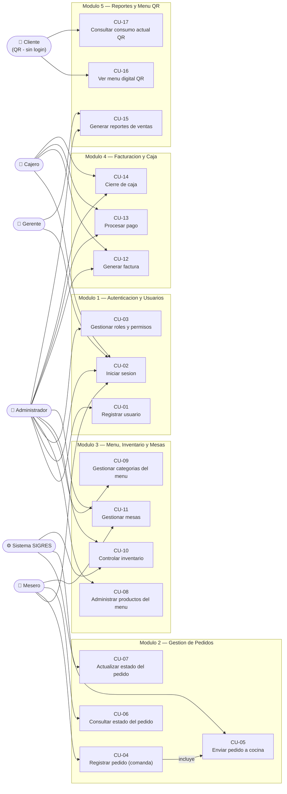

# Diagrama de Casos de Uso — SIGRES

**Proyecto:** Sistema Integral de Gestion para Restaurantes
**Version:** 1.0 | **Fecha:** Noviembre 2026
**Basado en:** SRS-SIGRES v1.0

---

## Actores del sistema

| Actor | Tipo | Plataforma | Descripcion |
|---|---|---|---|
| **Administrador** | Principal | Web | Gestion total del sistema |
| **Mesero** | Principal | App Movil | Registro de pedidos y mesas |
| **Cajero** | Principal | Web | Facturacion y pagos |
| **Gerente** | Principal | Web | Reportes e indicadores |
| **Cliente** | Principal | QR Movil | Menu digital sin login |
| **Sistema SIGRES** | Secundario | Interno | Logica automatizada |

---

## Diagrama UML de Casos de Uso

---

## Relaciones entre casos de uso

| Relacion | Tipo | Descripcion |
|---|---|---|
| CU-04 → CU-05 | `<<include>>` | Registrar pedido siempre incluye enviarlo a cocina |
| CU-04 → CU-06 | `<<extend>>` | El mesero puede consultar el estado tras registrar |
| CU-12 → CU-13 | `<<extend>>` | Generar factura puede extenderse a procesar pago |
| CU-16 → CU-17 | `<<extend>>` | Ver menu puede extenderse a ver consumo si hay pedido activo |
| CU-02 → CU-03 | `<<extend>>` | Iniciar sesion extiende la gestion de roles para el admin |

---

## Caracterizacion de Casos de Uso

### CU-01: Registrar Usuario

| Campo | Detalle |
|---|---|
| **Actor principal** | Administrador |
| **RF asociado** | RF01 |
| **Prioridad** | Alta — Critico |
| **Precondicion** | El administrador esta autenticado |
| **Postcondicion** | Usuario creado con rol asignado, puede iniciar sesion |
| **Flujo principal** | 1. Admin accede a gestion de usuarios → 2. Selecciona "Nuevo usuario" → 3. Ingresa datos y rol → 4. Sistema valida correo unico → 5. Usuario creado y confirmado |
| **Error principal** | Correo duplicado: "El correo ya esta registrado" |

### CU-02: Iniciar Sesion

| Campo | Detalle |
|---|---|
| **Actor principal** | Administrador / Mesero / Cajero / Gerente |
| **RF asociado** | RF02 |
| **Prioridad** | Alta — Critico |
| **Precondicion** | Usuario registrado con credenciales activas |
| **Postcondicion** | Usuario accede al panel segun su rol (token JWT generado) |
| **Flujo principal** | 1. Usuario ingresa correo y contrasena → 2. Sistema valida → 3. Genera JWT → 4. Redirige al panel del rol |
| **Error principal** | "Correo o contrasena invalidos" / "Cuenta desactivada" |

### CU-04: Registrar Pedido (Comanda)

| Campo | Detalle |
|---|---|
| **Actor principal** | Mesero |
| **RF asociado** | RF04 |
| **Prioridad** | Alta — Critico |
| **Precondicion** | Mesero autenticado. Mesa seleccionada. Productos disponibles. |
| **Postcondicion** | Comanda registrada con ID unico. Enviada a cocina. Mesa en estado "Ocupada". |
| **Flujo principal** | 1. Mesero selecciona mesa → 2. Elige productos con cantidades y notas → 3. Confirma → 4. Sistema crea comanda → 5. Envia a cocina automaticamente |
| **Error principal** | "No fue posible registrar el pedido. Verifique su conexion." |

### CU-12: Generar Factura

| Campo | Detalle |
|---|---|
| **Actor principal** | Cajero / Administrador |
| **RF asociado** | RF12 |
| **Prioridad** | Alta — Critico |
| **Precondicion** | Pedido entregado asociado a la mesa |
| **Postcondicion** | Factura generada con detalle de consumo y total |
| **Flujo principal** | 1. Cajero selecciona mesa → 2. Sistema calcula total con impuestos → 3. Genera factura → 4. Cajero entrega al cliente |
| **Error principal** | "No hay consumo registrado para esta mesa." |

### CU-16: Ver Menu Digital QR

| Campo | Detalle |
|---|---|
| **Actor principal** | Cliente |
| **RF asociado** | RF16 |
| **Prioridad** | Alta |
| **Precondicion** | QR activo. Menu con productos. Dispositivo con camara e internet. |
| **Postcondicion** | Cliente ve el menu. No se modifica nada en el sistema. |
| **Flujo principal** | 1. Cliente escanea QR → 2. Sistema valida QR e identifica mesa → 3. Muestra menu por categorias con precios en tiempo real |
| **Regla clave** | El cliente NO puede realizar pedidos desde el QR |
| **Error principal** | "El codigo QR no es valido. Solicite al mesero asistencia." |

---

## Cobertura total

| Modulo | CU | Actores involucrados |
|---|---|---|
| Autenticacion | CU-01, CU-02, CU-03 | Admin, Mesero, Cajero, Gerente |
| Pedidos | CU-04, CU-05, CU-06, CU-07 | Mesero, Sistema |
| Menu / Inventario / Mesas | CU-08, CU-09, CU-10, CU-11 | Admin, Mesero |
| Facturacion | CU-12, CU-13, CU-14 | Cajero, Admin |
| Reportes | CU-15 | Admin, Gerente |
| Menu QR | CU-16, CU-17 | Cliente |

**Total casos de uso:** 17 | **Total actores:** 6 | **Cobertura RF:** 17/17 (100%)